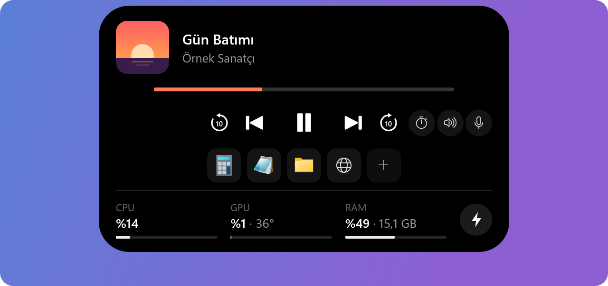
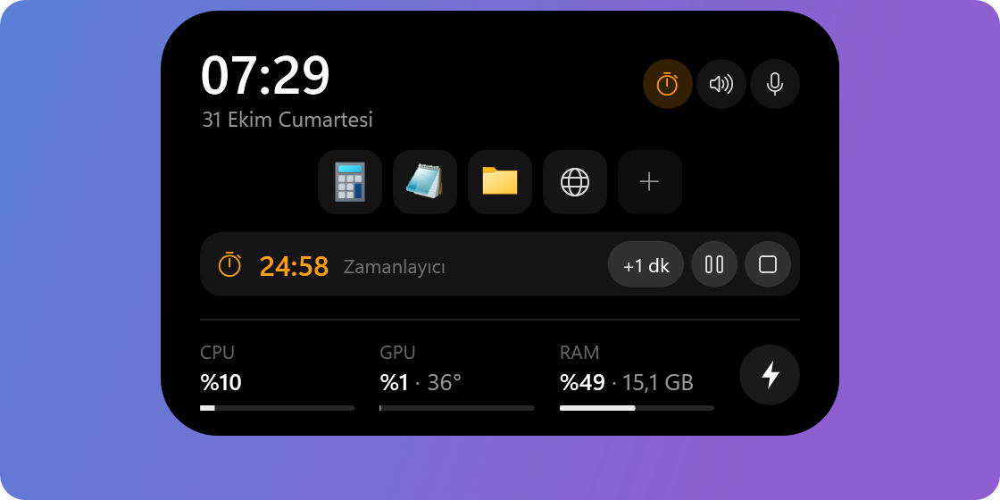
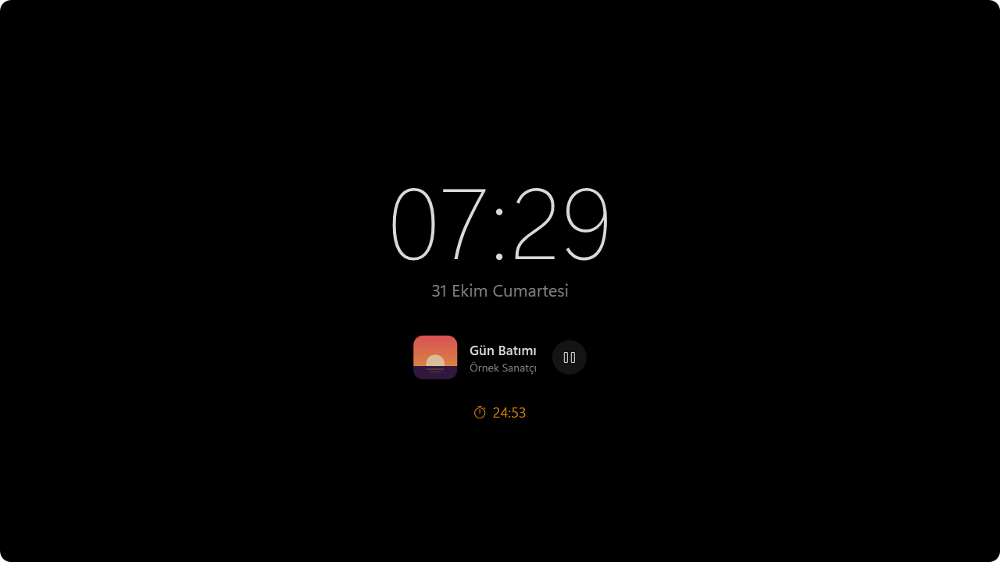

# ZeiLand

Windows 10/11 için hafif bir "Dynamic Island". Ekranın üst ortasında durur, olaylara göre şekil değiştirir. Türkçe ve İngilizce.

<p align="center">
  
</p>

## Kurulum

`ZEIGARN-Setup-<sürüm>.exe` ([Sürümler](https://github.com/zeigarn/ZeiLand/releases)) çalıştırılır.

> **"Windows kişisel bilgisayarınızı korudu" derse:** **Ek bilgi → Yine de çalıştır**. Kurulum dosyası kod imzalı olmadığı için Windows SmartScreen ilk kurulumda bu uyarıyı gösterir; virüs uyarısı değildir. İstenirse önce dosyaya sağ tık → Özellikler → **Engellemeyi kaldır** işaretlenir, uyarı hiç çıkmaz. Güncellemeler bu uyarı olmadan, sessizce kurulur.

Kurulum:

- Windows Türkçeyse Türkçe, değilse İngilizce açılır. Önce kullanım koşullarını gösterir (özet, MIT lisansı, gizlilik notu); kabul edilince devam eder.
- ZeiLand'i `Program Files\ZEIGARN\ZeiLand` altına kurar (.NET içinde gelir, ayrıca bir şey gerekmez) ve Başlat menüsüne ekler.
- İstenirse **PawnIO** sürücüsünü kurar (CPU sıcaklığı için; zaten kuruluysa bu seçenek görünmez).
- İstenirse **Windows ile başlat**: oturum açılınca ada UAC sormadan yönetici olarak başlar.
- Kaldırırken uygulamayı kapatır ve başlangıç görevini siler. Ayarlar (`%LOCALAPPDATA%\ZeiLand`) ve PawnIO yerinde kalır; PawnIO "Uygulamalar" listesinden ayrıca kaldırılır.
- İlk açılışta kısa bir **hoş geldin rehberi** çıkar (ipuçları, Windows ile başlat ve otomatik güncelleme seçimi). Sonradan Ayarlar → Hakkında'dan açılır.

## Özellikler

<p align="center">
  
</p>

| Durum | Ne zaman | Görünüm |
|---|---|---|
| Boşta | Hiçbir şey olmuyorken | Üst kenardan sarkan ince tutamak |
| Çalan medya | Spotify, tarayıcı vb. çalarken | Albüm kapağı (köşesinde çalan uygulamanın simgesi) + başlık + çalan sese göre oynayan çubuklar (kapak renginde) |
| Zamanlayıcı | Zamanlayıcı / kronometre çalışırken | Turuncu kronometre simgesi + kalan / geçen süre. Müzik de çalıyorsa çubukların yerinde |
| Genişlemiş oynatıcı | Fareyle üzerine gelince (medya varsa) | Kapak, başlık, sanatçı, ilerleme (tıklayıp sürükleyerek sarılır), ⟲10 ⏮ ⏯ ⏭ 10⟳, hızlı düğmeler + sistem bilgileri |
| Ana ekran | Fareyle üzerine gelince (medya yoksa) | Saat, tarih, pil, hızlı düğmeler + sistem bilgileri |
| Optimize | Sistem bilgilerindeki ⚡ düğmesi | En çok RAM/CPU kullanan uygulamalar (simgeleriyle) + kapat düğmeleri |
| Mikrofon / kamera | Bir uygulama kullanırken (her durumda) | Turuncu nokta = mikrofon, yeşil nokta = kamera, kırmızı üstü çizili mikrofon = kullanımda ama kapalı; üzerine gelince uygulama adı |
| Ses | Ses değişince | Seviye çubuğu + yüzde (1,8 sn) |
| Mikrofon | Mikrofon kapatılıp açılınca (ada, kısayol, kulaklık düğmesi) | "Mikrofon kapalı / açık" + kısayol (1,8 sn) |
| Ses çıkışı | Varsayılan çıkış değişince (ör. kulaklık bağlanınca) | Kulaklık / hoparlör simgesi + cihaz adı (2,5 sn) |
| Güç | Şarj takılıp çıkınca / pil %20 ve %10 | Pil simgesi + durum (1,8 sn) |
| Süre doldu | Zamanlayıcı bitince | Zil + "Süre doldu", Windows alarm sesi; "Tamam"a basılana kadar kalır |

<p align="center">
  
</p>
<p align="center">
  
</p>

- Adanın üzerinde **fare tekerleği** sesi açar veya kısar.
- Tepsi simgesine **sol tık** ayarları açar. Ada'ya veya tepsi simgesine **sağ tık**, ayarlar penceresiyle aynı tarzda koyu bir menü açar: Ayarlar, Windows ile başlat (anahtar), Çıkış.
- Tam ekran bir uygulama (oyun, video) açılınca ada **kendiliğinden gizlenir** (Ayarlar → Davranış → Tam ekranda gizle). Bu kapatılırsa ada oyunun üstünde kalır; ama oyun "tam ekran" (exclusive) modundaysa Windows üstüne hiçbir pencere çizmez, oyunun "kenarlıksız" moda alınması gerekir.
- Büyütülmüş bir pencere (ör. tarayıcı sekmeleri) adanın altına uzandığında kompakt oynatıcı varsayılan olarak görünür kalır. İstenirse (Ayarlar → Görünüm → İnce çizgi) **yer açar**: ince tutamağa döner, çalan bir şey varsa tutamakta kapak renginde (zamanlayıcıda turuncu) ince bir çizgi kalır. Üzerine gelince yine açılır.
- **Ctrl + sürükle** adayı taşır: üst kenar boyunca ya da başka bir ekrana. Ortaya yaklaşınca yerine oturur. Konum, ekran ve genişliğin oranı olarak saklanır; çözünürlük veya ölçek değişse de yerinde kalır. Ekran çıkarılırsa ana ekrana döner.

### Hızlı düğmeler

Açık adada (ana ekran ve oynatıcı) üç yuvarlak düğme:

- **Zamanlayıcı:** 1, 3, 5, 10, 15, 25, 45, 60 dakika ya da kronometre. Çalışırken açık adada bir şerit çıkar: süre, duraklat / devam, +1 dk, durdur. Ada kapalıyken kompakt görünümde süre görünür.
- **Ses:** Çıkış ve Giriş sekmeleri etkin çıkış cihazlarını ve mikrofonları listeler (seçili olanda ✓). Seçilen cihaz medya, oyun ve görüşmeler için varsayılan olur (Windows Ses ayarlarının yaptığı gibi); mikrofon kısayolu da seçilen mikrofonu kapatır.
- **İleri / geri sarma:** Sarılabilen oynatıcılarda (çoğu tarayıcı ve uygulama; Windows'a "konum değiştirilebilir" diyenler) açık oynatıcıda ⟲ ⟳ düğmeleri çıkar, 10 sn (5 / 15 / 30 sn seçilebilir) atlar; art arda tıklamalar toplanır. Düğmeler varken açık ada biraz genişler.
- **Mikrofon:** Varsayılan kayıt cihazını kapatır / açar (Windows'un kendi mikrofon sessize alması; tüm uygulamalar sessizlik alır). Kapalıyken düğme kırmızıdır. Aynı işi her yerden **Ctrl+Alt+K** yapar (ayarlardan değiştirilir veya kaldırılır).

### Kısayollar

Sık kullanılan uygulamalar, dosyalar, klasörler ve web siteleri açık adada (ana ekran ve oynatıcı) simge olarak durur, tek tıkla açılır; en fazla 8 tane. Ayarlar → Kısayollar'dan eklenir, sıralanır, kaldırılır (adadaki **+** de oraya götürür). Uygulama seçici Başlat menüsündeki "Tüm uygulamalar" listesini gösterir (masaüstü ve Store uygulamaları). Açılan her şey `explorer.exe` üzerinden başlatılır; ada yönetici olarak çalışsa da uygulamalar normal kullanıcı olarak açılır.

### GIF

Ayarlar → Görünüm'den bir GIF seçilir; açık oynatıcının sol altında, kontrollerin yanında oynar. Dosyanın bir kopyası `%LOCALAPPDATA%\ZeiLand\gif` altında tutulur. Kareler bir kez, arka planda ve gösterileceği boyutta hazırlanır (GIF karelerinin konumları, bekleme süreleri ve "dispose" kuralları uygulanır); uzun GIF'lerde en çok 150 kare tutulur. Yalnızca oynatıcı ekrandayken oynar.

### Always on display (AOD)

Ayarlar → AOD'den açılır (sağ tık menüsünde de anahtarı var). Siyah, kısık parlaklıkta tam ekranda büyük saat, tarih, çalan şarkı (oynat/duraklat ile), çalışan zamanlayıcı, pil ve mikrofon/kamera ışıkları; hangilerinin görüneceği seçilir.

<p align="center">
  
</p>

- **Ne zaman:** "Boşta kalınca" (1, 2, 5 ya da 10 dakika fare/klavye kullanılmayınca; fare oynayınca ya da bir tuşa basılınca kapanır) ya da "Hep açık" (ör. ikinci ekranda; çift tıklayınca kapanır).
- **Ekran:** adanın ekranı, belirli bir ekran ya da hepsi (birden çok ekran varsa).
- "Boşta kalınca", bırakılmış tam ekran bir oyunun üstüne de açılır; oyun kumandası (Xbox uyumlu) da girdi sayılır, kumandayla oynarken araya girmez. Tam ekran izlenen bir videonun (tarayıcı, Filmler ve TV, VLC, MPC, PotPlayer…) üstüne açılmaz. Ekranı tek başına tutan (exclusive) tam ekran bir oyunun üstüne açılmaz; onun üstünde hiçbir pencere görünmez, oyunu tam ekrandan da düşürebilir. "Hep açık", tam ekran uygulamanın olduğu ekranı atlar; oyun bir ekrandayken diğer ekranda açık kalır. Odağı hiçbir zaman almaz.
- Görünürken ekran kapanmaz (`SetThreadExecutionState`). İz kalmasın diye içerik dakikada bir birkaç piksel kayar.
- Hafif: dakikada bir (zamanlayıcı çalışırken saniyede bir) yeniden çizilir. Boşluk beklenirken, birkaç dakikada bir tek bir zamanlayıcı çalışır (kumanda takılıysa ona iki saniyede bir bakılır); girdi yalnızca AOD görünürken sık izlenir.
- "Önizle" düğmesi AOD'yi hemen gösterir.

### Güncellemeler

ZeiLand, [GitHub sürümlerini](https://github.com/zeigarn/ZeiLand/releases) açılıştan kısa süre sonra ve altı saatte bir kontrol eder (tek küçük istek). Yeni sürüm varsa kurulum dosyasını indirir, GitHub'ın verdiği SHA-256 ile doğrular ve uygun bir anda (ada kapalı, zamanlayıcı yok, tam ekran oyun/video yok) sessizce kurar; ada "yükleniyor" der, birkaç saniye içinde yeni sürümle açılır ve "güncellendi" der. Ayarlar → Hakkında'dan kapatılabilir ya da elle denetlenebilir. Bunun dışında hiçbir yere bir şey gönderilmez.

### Ayarlar

Ayarlar penceresindeki her değişiklik anında uygulanır ve `%LOCALAPPDATA%\ZeiLand\settings.json` dosyasına kaydedilir.

- **Dil:** Türkçe ya da İngilizce (Davranış sekmesinde; varsayılan Windows'un dili). Açık pencereler anında değişir.
- **Ada / Adada göster:** çalan medya (ve oynayan çubuklar), ses göstergesi, şarj bildirimleri, mikrofon/kamera ışıkları, saat/tarih, sistem bilgileri; sistem bilgilerinde CPU, CPU °C, GPU, GPU °C, RAM tek tek seçilir. Kapatılan bilgi hiç ölçülmez. **Kaynaklar:** medya çalan uygulamalar listelenir; işareti kaldırılanın medyası adada gösterilmez (o çalarken başka bir oynatıcınınki, önce çalanı, gösterilir).
- **Ada / CPU sıcaklığı:** durumunu gösterir; gerekiyorsa sürücüyü kurar veya uygulamayı yönetici olarak yeniden başlatır.
- **Görünüm:** kapalıyken görünüm (mini oynatıcı / ince çizgi, resimli önizlemeyle), konum ("Ortaya al"), oynatıcıdaki GIF, ileri / geri sarma süresi (kapalı / 5 / 10 / 15 / 30 sn) ve hangi hızlı düğmelerin (zamanlayıcı / kronometre, ses giriş / çıkış, mikrofon) görüneceği.
- **AOD:** yukarıdaki gibi.
- **Kısayollar:** yukarıdaki gibi.
- **Davranış:** açılma gecikmesi (anında / normal / yavaş), tekerlekle ses ve bir tıkın adımı (%1 / %2 / %5), mikrofon kısayolu (düğmeye basıp yeni tuşlara basılır; Esc vazgeçer, Geri tuşu kaldırır; başka bir uygulama kullanıyorsa uyarır), zamanlayıcı sesi, tam ekranda gizle (kapalıyken ada oyunun üstünde kalır; ama oyun "tam ekran" (exclusive) modundaysa üstünde hiçbir pencere görünmez, oyun "kenarlıksız" moda alınmalı, ör. LoL'de Ayarlar → Video → Pencere modu), Windows ile başlat.
- **Hakkında:** sürüm, otomatik güncelleme, hoş geldin rehberi, lisans, ayarları sıfırla (kısayollar ve GIF kalır).

### Mikrofon ve kamera ışıkları

Apple cihazlardaki gibi: bir uygulama mikrofonu kullanırken **turuncu**, kamerayı kullanırken **yeşil** nokta yanar. Ada kapalıyken de görünür (dinlenme tutamağı biraz uzar), kompakt oynatıcıda çubukların yanında, açık durumlarda üst kenarda durur. Noktanın üzerine gelince hangi uygulama olduğu yazar. Mikrofon kapalıyken (ör. görüşmede sessizdeyken) turuncu nokta yerine kırmızı, üstü çizili küçük bir mikrofon görünür.

Kaynaklar doğrudan donanımı kullananlardır, hiçbir şey sürekli kontrol edilmez:

- **Mikrofon:** Core Audio'da etkin bir kayıt oturumu olan süreçler (ses karıştırıcısının gördüğü). Bir oturum açılınca, başlayıp durunca ya da bir kayıt cihazı takılıp çıkınca Windows haber verir (`IAudioSessionNotification`, `IAudioSessionEvents`); ancak o zaman oturumlar yeniden listelenir.
- **Kamera:** Kameradan görüntü alan süreçler, Windows'un kamera çerçeve sunucusunun bildirdiği şekliyle (Media Foundation `IMFSensorActivityMonitor`). Değişince rapor gelir.

0.5.0'a kadar Windows'un gizlilik göstergesi kaydı (`CapabilityAccessManager\ConsentStore`) okunuyordu; yeni Windows sürümleri bu kaydı güncellemeyi bıraktığı için Discord gibi uygulamalar görünmüyordu.

### Optimize

Sistem bilgilerinin yanındaki ⚡ düğmesi, oturumunda en çok bellek ve işlemci kullanan uygulamaları simgeleriyle listeler. Bir uygulamanın penceresiz yardımcı süreçleri, onu başlatan uygulamanın satırında toplanır (ör. `Brave ×16`, Steam'in tarayıcı süreçleri `Steam` altında); fareyle satırın üzerine gelince dosya yolu görünür. Liste yalnızca panel açıkken, iki saniyede bir yenilenir; fare listenin üzerindeyken satırlar yer değiştirmez.

- **Kapat:** Uygulamadan penceresini kapatmasını ister; kaydedilmemiş iş varsa uygulama sorar.
- **Sonlandır:** Penceresi olmayan ya da kapanmayı reddeden (ör. tepsiye küçülen) uygulamalar için. İkinci tıkla onaylanır.
- Kapanan uygulama için ne kadar bellek boşaldığı yazılır.
- Windows'un çalışması için gereken süreçler (`explorer`, `dwm`, `svchost`, `csrss` vb.), servisler ve diğer kullanıcıların süreçleri hiç listelenmez.

"RAM temizleyici" türü araçlar gibi çalışan uygulamaların belleğini zorla diske itmez; bu Windows'u yavaşlatır. Gerçek kazanç, kullanılmayan uygulamayı kapatmaktır.

### Sistem bilgileri

Ada açıkken alt satırda saniyede bir güncellenir. CPU sıcaklığı dışındakiler yönetici izni istemez.

| Değer | Kaynak |
|---|---|
| CPU kullanımı | `GetSystemTimes` |
| RAM kullanımı / kullanılan GB | `GlobalMemoryStatusEx` |
| GPU kullanımı | PDH `GPU Engine` sayaçları (Görev Yöneticisi gibi: en meşgul motor) |
| GPU sıcaklığı | D3DKMT `ADAPTERPERFDATA` (Görev Yöneticisi'nin kaynağı) |
| CPU sıcaklığı | [LibreHardwareMonitor](https://github.com/LibreHardwareMonitor/LibreHardwareMonitor) + [PawnIO](https://github.com/namazso/PawnIO) sürücüsü (Ryzen: Tctl/Tdie, Intel: Package) |

En çok VRAM'e sahip adaptör (ekran kartı) seçilir; işlemcinin dahili GPU'su atlanır. Sıcaklıklar 80 °C'de turuncu, 90 °C'de kırmızı olur.

**CPU sıcaklığı** için Windows'ta sürücüsüz bir yol yoktur (HWiNFO ve LibreHardwareMonitor da sürücü kullanır). Gerekenler:

1. **PawnIO sürücüsü**, bir kez kurulur. Ayarlar → CPU sıcaklığı → "PawnIO'yu kur" (`winget install namazso.PawnIO`) ya da [PawnIO.Setup sürümleri](https://github.com/namazso/PawnIO.Setup/releases).
2. **Yönetici modu.** "Windows ile başlat" açıksa ada her oturumda Görev Zamanlayıcı üzerinden UAC sormadan yönetici olarak başlar. Elle açılırsa bir kez UAC sorar; reddedilirse sıcaklık olmadan çalışır.

Sensör yalnızca CPU sıcaklığı gösterilirken ve ada ilk açıldığında başlatılır.

## Performans tasarımı

- **Boşta CPU ≈ 0:** Polling yok. Medya (GSMTC), ses (Core Audio), güç ve tam ekran bilgileri Windows'tan olay olarak gelir.
- **Animasyon yalnızca hareket varken çalışır:** Yay (spring) fiziği `CompositionTarget.Rendering`'e sadece animasyon süresince bağlanır.
- **Şekil değişimi düzen hesabı yapmaz:** Ada, tek bir `RectangleGeometry` kırpma alanının yay ile animasyonudur.
- **Yazılımsal çizim:** Direct3D/GPU sürücüsü sürece yüklenmez. Ölçülen: private bellek 86 MB → ~20 MB, animasyon CPU'su aynı.
- **Ek bağımlılık yok:** NAudio, WinForms vb. kullanılmaz. Tepsi, ses ve güç doğrudan Win32/COM ile.
- **Çubuklar gerçek sese göre, yalnızca görünürken oynar:** Kompakt medya görünümü ekrandayken ve müzik çalarken, saniyede ~30 kez Core Audio'nun tepe seviye ölçeri (`IAudioMeterInformation`, ses karıştırıcısındaki çubuğun kaynağı) okunur. Ses verisi alınmaz, FFT yapılmaz. Otomatik kazanç sessiz ve gürültülü şarkıları eşit canlı gösterir; sessizlikte çubuklar durur ve yeniden çizim olmaz. Duraklatınca, ada açılınca veya tam ekranda okuma da durur.
- **Çubuklar yalnızca çalan uygulamayı dinler:** Ölçer, medyayı çalan uygulamanın kendi ses oturumlarından okunur (ses karıştırıcısındaki uygulama çubuğu); Discord'daki konuşma veya bir oyunun sesi çubukları oynatmaz. Uygulamanın ayrı bir ses oturumu yoksa tüm çıkışa geri dönülür.
- **Üstteki pencere olayla izlenir:** Ön plandaki pencere değişince ve yalnızca o uygulamanın pencereleri taşınınca/boyutlanınca Windows haber verir (`SetWinEventHook`); pencerenin gerçek sınırı DWM'den okunur. Zamanlayıcı yok.
- **Kısayol klavye kancası değildir:** `RegisterHotKey`; Windows yalnızca o tuş birleşimine basılınca mesaj gönderir.
- **Zamanlayıcı saymaz:** Geri sayımın bitişi tek bir zamanlayıcıyla beklenir; süre, yalnızca ekrandayken ve rakam değiştiği anda (saniyede bir) yeniden çizilir.
- **Sistem bilgileri yalnızca ada açıkken okunur:** Arka planda hiçbir ölçüm çalışmaz.
- **Heap üst sınırı (64 MB):** .NET gen0 bütçesini L3 önbelleğe göre ayarlar; 96 MB L3'lü işlemcide toplamalar arasında ~65 MB çöp birikiyordu. Sınır bütçeyi ~5 MB'a indirir (test: tepe bellek 117 MB → 36 MB).

Ölçüm (Release, ReadyToRun, Ryzen 7 9800X3D, 2560×1440):

| | |
|---|---|
| Boşta CPU (10 sn) | 0 ms |
| Kurulu sürüm, yayın açıkken, tutamak kipinde (10 sn) | makinenin %0,06'sı |
| Müzik çalarken (çubuklar oynarken) | ~3 ms/sn (tek çekirdeğin ~%0,3'ü) |
| Ada açıkken sistem bilgisi okuma | ~5 ms/örnek, saniyede bir |
| Optimize paneli açıkken süreç taraması | ~5–7 ms/örnek, iki saniyede bir |
| Bir ses göstergesi aç/kapa | ~170 ms CPU toplam |
| Private bellek (kullanım altında) | ~26–33 MB |
| Working set | ~100 MB (çoğu paylaşılan sistem DLL'leri; WPF açılışta GPU sürücüsünü de yükler) |

## Derleme

Gereken: .NET 10 SDK.

```bash
dotnet build ZeiLand/ZeiLand.csproj -c Release
```

Çalıştırılabilir klasör (.NET 10 Desktop Runtime kurulu makineler için):

```bash
dotnet publish ZeiLand/ZeiLand.csproj -c Release -r win-x64 --self-contained false -o publish
```

Kurulum paketi (`installer/out/ZEIGARN-Setup-<sürüm>.exe`). Gereken: [Inno Setup 6](https://jrsoftware.org/isinfo.php) (`winget install JRSoftware.InnoSetup`). Betik uygulamayı .NET dahil yayımlar, PawnIO'nun resmi kurulumunu indirip SHA-256 ile doğrular ve paketi derler:

```bash
powershell -ExecutionPolicy Bypass -File installer/build.ps1
```

Uygulama simgesi `ZeiLand/tools/make-icon.ps1` ile üretilir.

### Sürüm yayınlama

Kurulu kopyaların kendini güncellemesi için: `ZeiLand/ZeiLand.csproj` içindeki `<Version>` artırılır, commit'lenip push'lanır, sonra paket derlenip GitHub'da bir sürüm (`v<sürüm>`, ek dosya `ZEIGARN-Setup-<sürüm>.exe`) açılır. Gereken: [GitHub CLI](https://cli.github.com) (`winget install GitHub.cli`, `gh auth login`). Depo herkese açık olmalıdır; kurulu uygulamalar sürümleri oturum açmadan okur. Sürüm notlarının başına SmartScreen uyarısının nasıl geçileceği (Türkçe ve İngilizce) eklenir.

```bash
powershell -ExecutionPolicy Bypass -File installer/release.ps1
```

## Proje yapısı

```
ZeiLand/
  App.xaml.cs              başlangıç, servislerin bağlanması, tek örnek / yönetici olarak yeniden başlatma
  IslandWindow.xaml(.cs)   ada penceresi, durumlar, animasyon, paneller (optimize, ses giriş / çıkış, zamanlayıcı)
  IslandWindow.Media.cs    ilerleme çubuğunda sarma, ileri / geri düğmeleri, çalan uygulamanın simgesi
  IslandWindow.Placement.cs konum, Ctrl + sürükle ile taşıma, birden çok ekran
  AlwaysOnDisplay.cs       AOD'nin ne zaman / hangi ekranda açılacağı
  AodWindow.xaml(.cs)      AOD ekranı
  Loc.cs                   Türkçe / İngilizce metinler ({DynamicResource} ile canlı dil değişimi)
  SettingsWindow.xaml(.cs) ayarlar penceresi (kısayol kaydedici dahil)
  SettingsWindow.Pages.cs  sekmeler, Görünüm, Kısayollar ve Hakkında sayfaları
  WelcomeWindow.xaml(.cs)  ilk açılıştaki hoş geldin rehberi
  TrayMenu.xaml(.cs)       tepsi / sağ tık menüsü
  Settings/                AppSettings (bağlanabilir ayarlar), ShortcutItem, SettingsStore (JSON kaydı)
  Animation/               SpringAnimator (yay fiziği), LevelMeter (sese göre çubuklar)
  Controls/BatteryGlyph    OnRender ile çizilen pil simgesi
  Controls/StatsPanel      CPU / GPU / RAM satırı + optimize düğmesi
  Controls/QuickActions    zamanlayıcı / ses / mikrofon düğmeleri (ayarlardan seçilir)
  Controls/TimerStrip      çalışan zamanlayıcı şeridi
  Controls/ShortcutBar     kullanıcının kısayol simgeleri
  Controls/GifImage        yalnızca ekrandayken oynayan, önceden hazırlanmış GIF
  Services/                Media, Volume, Microphone, AudioDevices, Power, SystemStats, CpuTemperatureReader,
                           ProcessMonitor, PrivacyMonitor, TopWindowWatcher, TimerService, Hotkeys, AppIcons,
                           FullscreenWatcher, TrayIcon, Autostart, Elevation, Shortcuts, UpdateService, Displays, Gamepads
  Native/                  Win32, Core Audio, Media Foundation (kamera etkinliği), D3DKMT ve PDH tanımları
installer/
  ZeiLand.iss              Inno Setup betiği (ZEIGARN kurulumu)
  build.ps1                yayımla + PawnIO'yu indir/doğrula + paketle
  release.ps1              paketle + GitHub sürümü aç
  license-tr.txt, -en.txt  kurulumda kabul edilen koşullar (özet + MIT + gizlilik)
  THIRD-PARTY-NOTICES.txt  üçüncü taraf lisansları (kurulumla gelir)
docs/images/               README görselleri (uygulamanın kendi çizimi, örnek içerikle)
```

## Lisans

[MIT](LICENSE) © 2026 ZEIGARN.

## Üçüncü taraf

- [LibreHardwareMonitorLib](https://github.com/LibreHardwareMonitor/LibreHardwareMonitor) (MPL-2.0): CPU sıcaklığı.
- [PawnIO](https://github.com/namazso/PawnIO) (GPL-2.0): ZeiLand'in parçası değildir. Kurulum paketi resmi, imzalı `PawnIO_setup.exe`'yi değiştirmeden içerir ve yalnızca kullanıcı seçerse çalıştırır (`-install -silent`).
