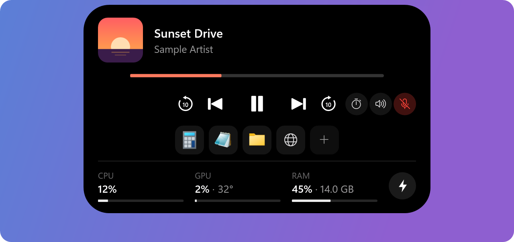
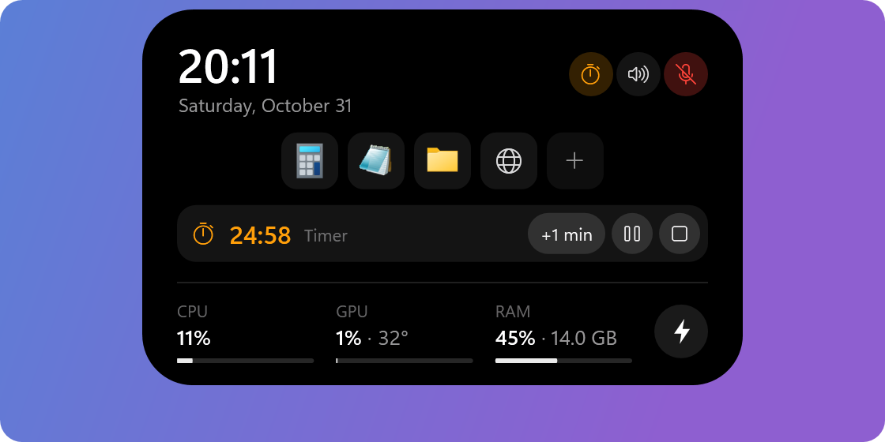
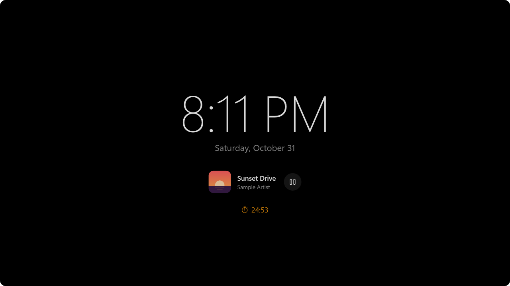

# ZeiLand

**English** | [Türkçe](README.tr.md)

A lightweight "Dynamic Island" for Windows 10/11. It sits at the top centre of the screen and changes shape with what is happening. In English and Turkish.

<p align="center">
  
</p>

## Installing

Run `ZEIGARN-Setup-<version>.exe` (from [Releases](https://github.com/zeigarn/ZeiLand/releases)).

> **If Windows says "Windows protected your PC":** click **More info → Run anyway**. The setup isn't code-signed, so Windows SmartScreen shows this on the first install; it isn't a virus warning. To avoid it entirely, right-click the file → Properties → tick **Unblock** first. Updates install silently, without this warning.

The setup:

- Opens in Turkish if Windows is in Turkish, otherwise in English. It first shows the terms (a summary, the MIT license and a privacy note) and continues once they are accepted.
- Installs ZeiLand under `Program Files\ZEIGARN\ZeiLand` (.NET comes with it, nothing else is needed) and adds it to the Start menu.
- Optionally installs the **PawnIO** driver (for the CPU temperature; the option is hidden if it is already installed).
- Optionally sets up **Start with Windows**: the island starts as administrator at sign-in, without a UAC prompt.
- When uninstalling, it closes the app and removes the startup task. Settings (`%LOCALAPPDATA%\ZeiLand`) and PawnIO stay; PawnIO is removed separately from the Apps list.
- On first launch a short **welcome guide** appears (tips, Start with Windows and automatic updates). It can be opened again from Settings → About.

## Features

<p align="center">
  
</p>

| State | When | Looks like |
|---|---|---|
| Idle | Nothing is happening | A thin handle hanging from the top edge |
| Now playing | Spotify, a browser etc. is playing | Album cover (with the playing app's icon in its corner) + title + bars moving with the sound being played (in the cover's colour) |
| Timer | A timer / stopwatch is running | Orange stopwatch icon + time left / elapsed. In place of the bars if music is playing too |
| Open player | On hover (with media) | Cover, title, artist, progress (click and drag to seek), ⟲10 ⏮ ⏯ ⏭ 10⟳, quick buttons + system stats |
| Home | On hover (no media) | Clock, date, battery, quick buttons + system stats |
| Optimize | The ⚡ button in the system stats | The apps using the most RAM/CPU (with their icons) + close buttons |
| Microphone / camera | An app is using one (in every state) | Orange dot = microphone, green dot = camera, red struck-through microphone = in use but muted; hover for the app's name |
| Volume | The volume changes | Level bar + percentage (1.8 s) |
| Microphone | The microphone is muted / unmuted (island, shortcut, headset button) | "Microphone off / on" + shortcut (1.8 s) |
| Sound output | The default output changes (e.g. headphones plugged in) | Headphones / speaker icon + device name (2.5 s) |
| Power | Charger plugged in / out, battery at 20% and 10% | Battery icon + status (1.8 s) |
| Time's up | A timer ends | Bell + "Time's up", Windows alarm sound; stays until "OK" is pressed |

<p align="center">
  
</p>
<p align="center">
  
</p>

- The **mouse wheel** over the island turns the volume up or down.
- **Left-click** on the tray icon opens the settings. **Right-click** on the island or the tray icon opens a dark menu in the same style as the settings window: Settings, Start with Windows (switch), Exit.
- When a full-screen app (a game, a video) opens, the island **hides by itself** (Settings → Behaviour → Hide in full screen). With this off, the island stays over the game; but if the game is in exclusive "full screen" mode, Windows draws no window over it, and the game has to be set to "borderless".
- When a maximised window (e.g. browser tabs) reaches under the island, the compact player stays visible by default. Optionally (Settings → Appearance → Thin line) it **makes room**: it shrinks to the thin handle, and if something is playing, a thin line in the cover's colour (orange for a timer) stays on the handle. Hovering opens it as usual.
- **Ctrl + drag** moves the island: along the top edge or to another screen. It snaps into place near the centre. The position is stored as a fraction of the screen's width, so it stays put when the resolution or scale changes. If the screen is removed, it goes back to the main screen.

### Quick buttons

Three round buttons in the open island (home and player):

- **Timer:** 1, 3, 5, 10, 15, 25, 45 or 60 minutes, or a stopwatch. While it runs, a strip appears in the open island: time, pause / resume, +1 min, stop. With the island closed, the time shows in the compact view.
- **Sound:** the Output and Input tabs list the active output devices and microphones (✓ on the selected one). The chosen device becomes the default for media, games and calls (as Windows Sound settings does); the microphone shortcut mutes the chosen microphone too.
- **Skip back / ahead:** for players that can seek (most browsers and apps; those that tell Windows their position can be changed), ⟲ ⟳ buttons appear in the open player and skip 10 s (5 / 15 / 30 s can be chosen); repeated clicks add up. With them, the open island gets a little wider.
- **Microphone:** mutes / unmutes the default recording device (Windows' own microphone mute; every app gets silence). The button is red while muted. **Ctrl+Alt+K** does the same from anywhere (changed or removed in the settings).

### Shortcuts

Frequently used apps, files, folders and websites sit as icons in the open island (home and player) and open with one click; up to 8 of them. They are added, ordered and removed in Settings → Shortcuts (the **+** on the island leads there too). The app picker shows the Start menu's "All apps" list (desktop and Store apps). Everything is launched through `explorer.exe`, so apps open as the normal user even though the island runs as administrator.

### GIF

Choose a GIF in Settings → Appearance; it plays at the bottom left of the open player, next to the controls. A copy of the file is kept under `%LOCALAPPDATA%\ZeiLand\gif`. The frames are prepared once, in the background and at the size they are shown (GIF frame positions, delays and "dispose" rules are applied); long GIFs keep at most 150 frames. It only plays while the player is on screen.

### Always on display (AOD)

Turned on in Settings → AOD (the right-click menu has a switch too). A large clock on a black, dimmed full screen, with the date, the song playing (with play/pause), a running timer, the battery and the microphone/camera lights; you choose which of them show.

<p align="center">
  
</p>

- **When:** "When idle" (after 1, 2, 5 or 10 minutes without mouse/keyboard input; it closes when the mouse moves or a key is pressed) or "Always" (e.g. on a second screen; double-click to close).
- **Screen:** the island's screen, a specific screen or all of them (with several screens).
- "When idle" also opens over a full-screen game left alone; a game controller (Xbox compatible) counts as input as well, so it doesn't get in the way while you play with one. It doesn't open over a video being watched in full screen (browser, Films & TV, VLC, MPC, PotPlayer…). It doesn't open over a game that holds the screen exclusively; no window shows over such a game, and trying could knock it out of full screen. "Always" skips the screen with the full-screen app; with a game on one screen, it stays on the other. It never takes the focus.
- The screen doesn't turn off while it shows (`SetThreadExecutionState`). The content shifts a few pixels every minute so nothing burns in.
- Light: it redraws once a minute (once a second while a timer runs). While it waits for idle, a single timer runs every few minutes (a connected controller is checked every two seconds); input is watched closely only while the AOD shows.
- The "Preview" button shows the AOD right away.

### Updates

ZeiLand checks the [GitHub releases](https://github.com/zeigarn/ZeiLand/releases) shortly after it starts and every six hours (one small request). If there is a new version, it downloads the setup, checks it against the SHA-256 GitHub provides and installs it silently at a good moment (island closed, no timer, no full-screen game/video); the island says "installing", comes back with the new version within a few seconds and says "updated". This can be turned off, or checked by hand, in Settings → About. Nothing is sent anywhere else.

### Settings

Every change in the settings window applies at once and is saved to `%LOCALAPPDATA%\ZeiLand\settings.json`.

- **Language:** Turkish or English (in the Behaviour tab; Windows' language by default). Open windows switch at once.
- **Island / Show on the island:** now playing (and the moving bars), the volume indicator, charging notices, the microphone/camera lights, clock/date, system stats; in the system stats, CPU, CPU °C, GPU, GPU °C and RAM are chosen one by one. Anything turned off isn't measured at all. **Sources:** the apps playing media are listed; an unticked app's media isn't shown on the island (while it plays, another player's is shown, the one that started first).
- **Island / CPU temperature:** shows its status; installs the driver or restarts the app as administrator if needed.
- **Appearance:** the closed look (mini player / thin line, with a picture preview), the position ("Centre"), the GIF in the player, the skip length (off / 5 / 10 / 15 / 30 s) and which quick buttons (timer / stopwatch, sound in / out, microphone) show.
- **AOD:** as above.
- **Shortcuts:** as above.
- **Behaviour:** open delay (instant / normal / slow), wheel for volume and the size of one notch (1% / 2% / 5%), microphone shortcut (press the button, then the new keys; Esc cancels, Backspace removes it; warns if another app uses it), timer sound, hide in full screen (with it off, the island stays over the game; but if the game is in exclusive "full screen" mode, no window shows over it, so set the game to "borderless", e.g. in LoL: Settings → Video → Window mode), Start with Windows.
- **About:** version, automatic updates, the welcome guide, the license, reset settings (shortcuts and the GIF stay).

### Microphone and camera lights

As on Apple devices: an **orange** dot lights up while an app uses the microphone, a **green** one while an app uses the camera. They show with the island closed too (the resting handle gets a little longer), next to the bars in the compact player and along the top edge in the open states. Hovering a dot shows which app it is. While the microphone is muted (e.g. muted in a call), a small red struck-through microphone shows instead of the orange dot.

The sources are the ones using the hardware directly; nothing is checked continuously:

- **Microphone:** processes with an active capture session in Core Audio (what the volume mixer sees). Windows reports when a session opens, starts or stops, or when a recording device is plugged in or out (`IAudioSessionNotification`, `IAudioSessionEvents`); only then are the sessions listed again.
- **Camera:** processes taking frames from a camera, as Windows' camera frame server reports them (Media Foundation `IMFSensorActivityMonitor`). A report comes when it changes.

Up to 0.5.0, Windows' privacy indicator registry (`CapabilityAccessManager\ConsentStore`) was read; newer Windows versions stopped updating it, so apps like Discord didn't show.

### Optimize

The ⚡ button next to the system stats lists the apps in your session using the most memory and processor, with their icons. An app's windowless helper processes are grouped on the row of the app that started them (e.g. `Brave ×16`, Steam's browser processes under `Steam`); hovering a row shows the file path. The list refreshes only while the panel is open, every two seconds; rows don't move while the mouse is over the list.

- **Close:** asks the app to close its window; if there is unsaved work, the app asks.
- **End task:** for apps with no window or that refuse to close (e.g. ones that minimise to the tray). Confirmed with a second click.
- How much memory was freed is shown for a closed app.
- Processes Windows needs to run (`explorer`, `dwm`, `svchost`, `csrss` etc.), services and other users' processes are never listed.

It doesn't force running apps' memory out to disk like "RAM cleaner" tools do; that slows Windows down. The real gain is closing the app you aren't using.

### System stats

Updated once a second in the bottom row while the island is open. Apart from the CPU temperature, none of them needs administrator rights.

| Value | Source |
|---|---|
| CPU usage | `GetSystemTimes` |
| RAM usage / GB used | `GlobalMemoryStatusEx` |
| GPU usage | PDH `GPU Engine` counters (like Task Manager: the busiest engine) |
| GPU temperature | D3DKMT `ADAPTERPERFDATA` (Task Manager's source) |
| CPU temperature | [LibreHardwareMonitor](https://github.com/LibreHardwareMonitor/LibreHardwareMonitor) + the [PawnIO](https://github.com/namazso/PawnIO) driver (Ryzen: Tctl/Tdie, Intel: Package) |

The adapter (graphics card) with the most VRAM is chosen; the processor's integrated GPU is skipped. Temperatures turn orange at 80 °C and red at 90 °C.

There is no driverless way to read the **CPU temperature** on Windows (HWiNFO and LibreHardwareMonitor use a driver too). It needs:

1. **The PawnIO driver**, installed once. Settings → CPU temperature → "Install PawnIO" (`winget install namazso.PawnIO`) or the [PawnIO.Setup releases](https://github.com/namazso/PawnIO.Setup/releases).
2. **Administrator mode.** With "Start with Windows" on, the island starts as administrator through Task Scheduler at every sign-in, without a UAC prompt. Opened by hand, it asks UAC once; if refused, it runs without the temperature.

The sensor starts only while the CPU temperature is shown and the island is first opened.

## Performance design

- **Idle CPU ≈ 0:** no polling. Media (GSMTC), sound (Core Audio), power and full-screen information come from Windows as events.
- **Animation runs only while something moves:** the spring physics hooks into `CompositionTarget.Rendering` only for the length of an animation.
- **Changing shape does no layout pass:** the island is a spring animation of a single `RectangleGeometry` clip.
- **Software rendering:** no Direct3D/GPU driver is loaded into the process. Measured: private memory 86 MB → ~20 MB, animation CPU the same.
- **No extra dependencies:** no NAudio, WinForms etc. Tray, sound and power go straight through Win32/COM.
- **The bars follow the real sound, only while visible:** while the compact media view is on screen and music is playing, Core Audio's peak meter (`IAudioMeterInformation`, the source of the volume mixer's bar) is read ~30 times a second. No audio data is taken and no FFT is done. Automatic gain makes quiet and loud songs look equally lively; in silence the bars stop and nothing is redrawn. Reading stops when paused, when the island opens or in full screen.
- **The bars listen only to the playing app:** the meter is read from the playing app's own audio sessions (the app's bar in the volume mixer); a Discord call or a game's sound doesn't move the bars. If the app has no separate audio session, it falls back to the whole output.
- **The top window is followed through events:** Windows reports when the foreground window changes, and only when that app's windows move or resize (`SetWinEventHook`); the window's real bounds come from DWM. No timer.
- **The shortcut isn't a keyboard hook:** `RegisterHotKey`; Windows sends a message only when that key combination is pressed.
- **The timer doesn't count:** the end of a countdown is awaited with a single timer; the time is redrawn only while on screen and only when a digit changes (once a second).
- **System stats are read only while the island is open:** no measurement runs in the background.
- **Heap limit (64 MB):** .NET sizes the gen0 budget by the L3 cache; on a processor with 96 MB of L3, ~65 MB of garbage piled up between collections. The limit brings the budget down to ~5 MB (test: peak memory 117 MB → 36 MB).

Measured (Release, ReadyToRun, Ryzen 7 9800X3D, 2560×1440):

| | |
|---|---|
| Idle CPU (10 s) | 0 ms |
| Installed version, while streaming, in handle mode (10 s) | 0.06% of the machine |
| With music playing (bars moving) | ~3 ms/s (~0.3% of one core) |
| Reading system stats while the island is open | ~5 ms/sample, once a second |
| Process scan while the Optimize panel is open | ~5–7 ms/sample, every two seconds |
| Showing/hiding a volume indicator | ~170 ms CPU in total |
| Private memory (in use) | ~26–33 MB |
| Working set | ~100 MB (mostly shared system DLLs; WPF also loads the GPU driver at startup) |

## Building

Needs: .NET 10 SDK.

```bash
dotnet build ZeiLand/ZeiLand.csproj -c Release
```

A runnable folder (for machines with the .NET 10 Desktop Runtime installed):

```bash
dotnet publish ZeiLand/ZeiLand.csproj -c Release -r win-x64 --self-contained false -o publish
```

The setup package (`installer/out/ZEIGARN-Setup-<version>.exe`). Needs [Inno Setup 6](https://jrsoftware.org/isinfo.php) (`winget install JRSoftware.InnoSetup`). The script publishes the app with .NET included, downloads PawnIO's official setup, checks it with SHA-256 and builds the package:

```bash
powershell -ExecutionPolicy Bypass -File installer/build.ps1
```

The app icon is made with `ZeiLand/tools/make-icon.ps1`.

### Publishing a release

For installed copies to update themselves: raise `<Version>` in `ZeiLand/ZeiLand.csproj`, commit and push, then build the package and open a GitHub release (`v<version>`, attached file `ZEIGARN-Setup-<version>.exe`). Needs the [GitHub CLI](https://cli.github.com) (`winget install GitHub.cli`, `gh auth login`). The repository must be public; installed apps read the releases without signing in. The release notes start with how to get past the SmartScreen warning (in Turkish and English).

```bash
powershell -ExecutionPolicy Bypass -File installer/release.ps1
```

## Project structure

```
ZeiLand/
  App.xaml.cs              startup, wiring the services, single instance / restart as administrator
  IslandWindow.xaml(.cs)   the island window, states, animation, panels (optimize, sound in / out, timer)
  IslandWindow.Media.cs    seeking on the progress bar, skip buttons, the playing app's icon
  IslandWindow.Placement.cs position, moving with Ctrl + drag, multiple screens
  AlwaysOnDisplay.cs       when / on which screen the AOD opens
  AodWindow.xaml(.cs)      the AOD screen
  Loc.cs                   Turkish / English texts (live language switch through {DynamicResource})
  SettingsWindow.xaml(.cs) the settings window (shortcut recorder included)
  SettingsWindow.Pages.cs  tabs, the Appearance, Shortcuts and About pages
  WelcomeWindow.xaml(.cs)  the welcome guide on first launch
  TrayMenu.xaml(.cs)       tray / right-click menu
  Settings/                AppSettings (bindable settings), ShortcutItem, SettingsStore (JSON storage)
  Animation/               SpringAnimator (spring physics), LevelMeter (bars following the sound)
  Controls/BatteryGlyph    battery icon drawn in OnRender
  Controls/StatsPanel      the CPU / GPU / RAM row + optimize button
  Controls/QuickActions    timer / sound / microphone buttons (chosen in the settings)
  Controls/TimerStrip      the running timer strip
  Controls/ShortcutBar     the user's shortcut icons
  Controls/GifImage        a GIF prepared in advance that plays only while on screen
  Services/                Media, Volume, Microphone, AudioDevices, Power, SystemStats, CpuTemperatureReader,
                           ProcessMonitor, PrivacyMonitor, TopWindowWatcher, TimerService, Hotkeys, AppIcons,
                           FullscreenWatcher, TrayIcon, Autostart, Elevation, Shortcuts, UpdateService, Displays, Gamepads
  Native/                  Win32, Core Audio, Media Foundation (camera activity), D3DKMT and PDH definitions
installer/
  ZeiLand.iss              Inno Setup script (the ZEIGARN setup)
  build.ps1                publish + download/check PawnIO + package
  release.ps1              package + open a GitHub release
  license-tr.txt, -en.txt  terms accepted during setup (summary + MIT + privacy)
  THIRD-PARTY-NOTICES.txt  third-party licenses (shipped with the setup)
docs/images/               README pictures (drawn by the app itself, with sample content; en/ with the English UI)
```

## License

[MIT](LICENSE) © 2026 ZEIGARN.

## Third party

- [LibreHardwareMonitorLib](https://github.com/LibreHardwareMonitor/LibreHardwareMonitor) (MPL-2.0): CPU temperature.
- [PawnIO](https://github.com/namazso/PawnIO) (GPL-2.0): not part of ZeiLand. The setup package includes the official, signed `PawnIO_setup.exe` unchanged and runs it only if the user chooses to (`-install -silent`).
